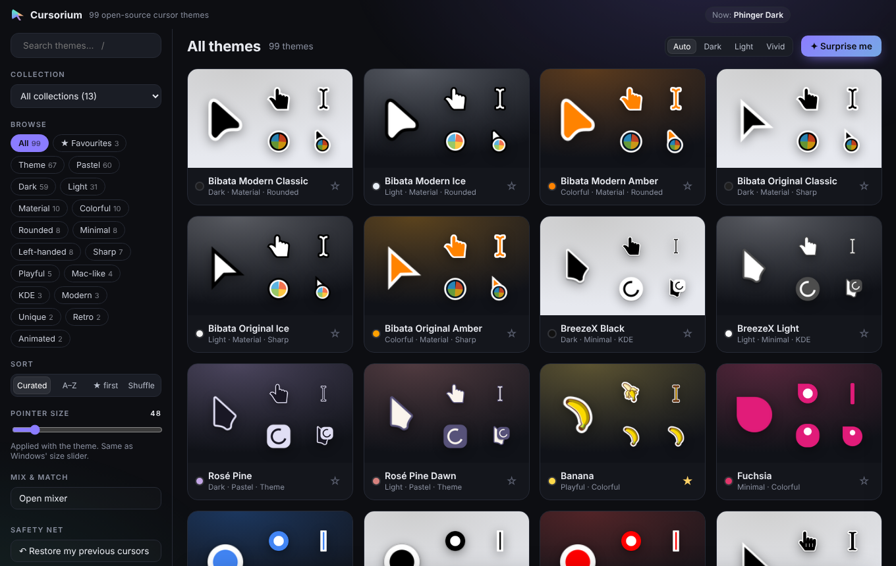
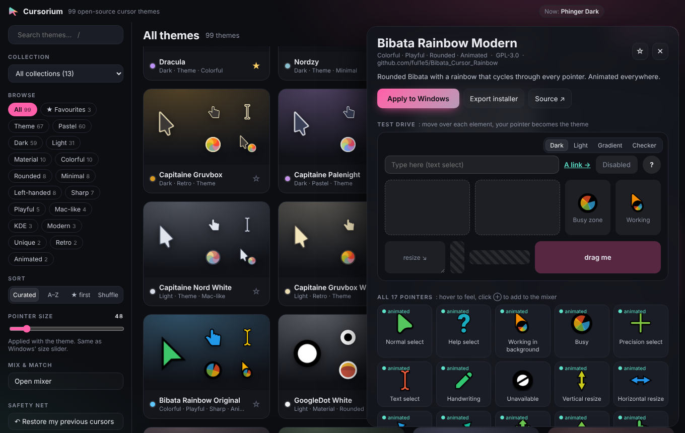

<p align="center"></p>

<h1 align="center">Cursorium</h1>
<p align="center"><b>A good-looking Windows cursor picker with 99 open-source cursor themes.</b><br>
Hover to feel them, test-drive every pointer, mix your own set, and apply it with one click.</p>

<p align="center"><a href="../../releases/latest"><b>⬇ Download Cursorium (portable .exe)</b></a></p>



## Features

- **99 themes, 13 families**: Bibata (incl. animated Rainbow), BreezeX, Rosé Pine, Catppuccin (56 flavour × accent combos), Phinger, Capitaine (Nord, Gruvbox, Palenight), GoogleDot, XCursor Pro, Nordzy, Dracula, Fuchsia, Banana, plus left-handed sets.
- **Live feel**: hover a card and your pointer *becomes* that theme.
- **Test drive**: text field, link, disabled button, pen canvas, crosshair pad, resize handles, drag-to-move and busy zones, on dark, light, gradient or checker backdrops.
- **All 17 Windows pointer roles**, with animated busy/working cursors (`.ani`) and multi-size `.cur` files that stay sharp on high-DPI screens.
- **One-click apply** plus a pointer-size slider (32–160 px).
- **Mixer**: build a scheme from pointers of different themes.
- **Safety net**: your original cursors are backed up the first time you apply; restore them or the Windows default anytime.
- **Export installer**: writes a classic right-click → *Install* folder (`install.inf`) to share a scheme without the app.
- Search, tag filters, collections, favourites, shuffle, recently applied, keyboard shortcuts (`← → ↑ ↓`, `Enter`, `A` apply, `F` favourite, `R` surprise, `M` mixer, `/` search).



## Install

Download `Cursorium-0.5.0-portable.exe` from [Releases](../../releases/latest) and run it. Nothing to install, no admin rights.

- The exe is unsigned, so Windows SmartScreen may say *"Windows protected your PC"*: **More info → Run anyway**.
- The portable exe unpacks itself to a temp folder on each launch, so startup takes a few seconds.
- Everything is per-user: registry changes go to `HKCU\Control Panel\Cursors`; applied cursor files go to `%LOCALAPPDATA%\Cursorium`.

## Build from source

```bash
npm install
bash scripts/build_themes.sh   # downloads the theme releases politely, converts them to .cur/.ani (themes/ is not committed)
npm start                      # run
npm run dist                   # build the portable exe
```

`scripts/convert.py` is a small X11 Xcursor → Windows `.cur` / `.ani` converter: it handles multiple sizes, hotspots, animation timing and theme inheritance. `scripts/fetch_release_assets.py` downloads only official GitHub release assets, one every 10 s, with an identified user agent, obeying robots.txt.

## Credits & licences

Cursorium's own code is MIT-licensed (see `LICENSE`). **The cursor themes are not mine.** They're the work of their authors, redistributed in converted form under their original licences (GPL-2.0/3.0, LGPL-3.0, CC-BY-SA-4.0). See [`CREDITS.txt`](CREDITS.txt) for every project and licence, and `licenses/` for the licence texts. Full thanks to [ful1e5](https://github.com/ful1e5), [Catppuccin](https://github.com/catppuccin/cursors), [phisch](https://github.com/phisch/phinger-cursors), [sainnhe](https://github.com/sainnhe/capitaine-cursors), [Rosé Pine](https://github.com/rose-pine/cursor), [guillaumeboehm](https://github.com/guillaumeboehm/Nordzy-cursors) and [Dracula](https://github.com/dracula/gtk).

